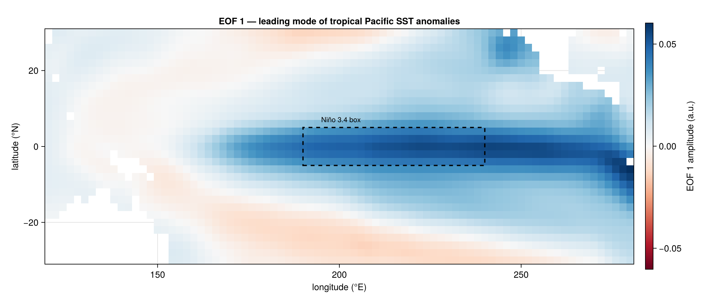
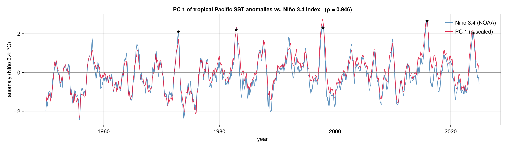
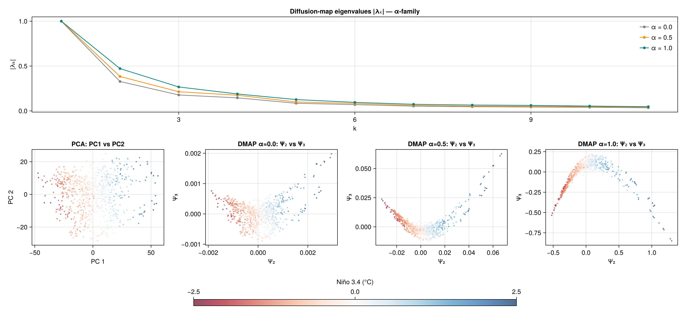
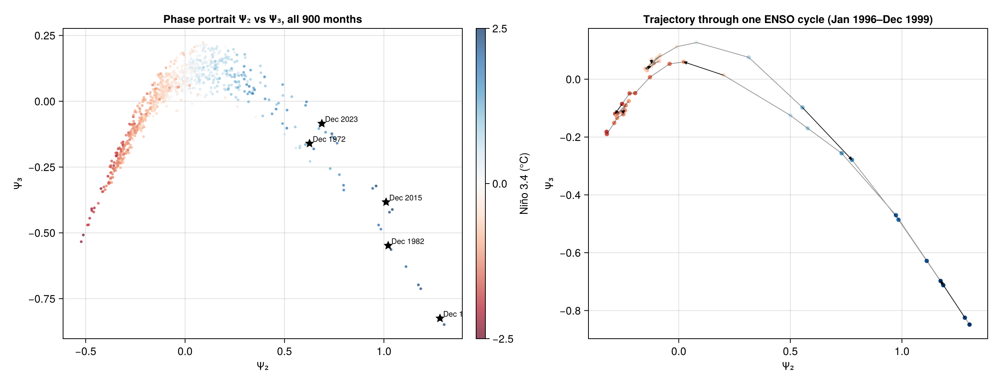

# Recovering ENSO-related structure from sea-surface temperature

**PCA and diffusion maps on monthly tropical-Pacific SST**

GEO 384H project · William Suan · revised meeting text

## Summary

The question is whether a low-dimensional representation of monthly sea-surface temperature (SST) can recover variation associated with El Niño–Southern Oscillation (ENSO). PCA provides a simple linear baseline. Diffusion maps provides a nonlinear representation based on similarities between monthly temperature fields.

The existing results report same-month correlations with Niño 3.4 of **0.946 for PCA** and **0.923 for diffusion maps at α = 1**. These values come from the saved project metrics, not a new run. PCA has the higher correlation on this comparison. Diffusion maps provides a different visualization, but the analysis does not establish better predictive performance or prove recovery of a physical attractor.

## 1. Question and computational work

ENSO includes warm and cool phases of tropical-Pacific variability. A monthly SST field contains many grid-cell measurements. The project asks: **can a few coordinates summarize ENSO-related variation, and what changes when a nonlinear method replaces a linear baseline?**

The repository contains a Julia workflow for loading SST, constructing anomalies, fitting PCA and diffusion maps, comparing their coordinates with Niño 3.4, and visualizing the results. This is an implementation and comparison of established methods, not a new ENSO model. Individual contributions should be described separately by the presenter and only to the extent they can be substantiated.

## 2. Data and scope

The recorded analysis uses NOAA ERSSTv5 from January 1950 through December 2024, restricted to 30°S–30°N and 120°E–80°W. The report records 900 monthly fields and 2,322 retained grid cells. Those counts have not been independently reproduced in this revision.

An anomaly is a departure from the average for that calendar month. The current workflow estimates this seasonal reference over the full analysis window, reshapes the fields into a month-by-grid-cell matrix, and applies weights intended to account for grid-cell area. The input alignment, missing-data mask, and weight ordering remain items for technical verification.

Niño 3.4 is an SST anomaly average over 5°S–5°N, 170°W–120°W. It is not a fitting target for either embedding. It is used afterward for sign alignment, correlations, and plot coloring. Because it shares the SST basis of the input, agreement is a useful physical interpretation check, not an independent validation dataset.

The embeddings and preprocessing use the full sample. A coordinate for a given month is compared with the index for that same month. **This is representation, not forecasting, and it is not held-out evaluation.**

## 3. Two methods

### PCA: the linear baseline

PCA finds spatial patterns that explain the largest variation in the temperature fields. A spatial pattern is often called an empirical orthogonal function (EOF); its monthly strength is the corresponding principal component (PC).

The implementation centers the matrix and computes its singular value decomposition in `src/pca.jl`. PCA optimizes explained variance, not correlation with Niño 3.4. A high correlation is therefore an observed result, not a guarantee of the method.

### Diffusion maps: a similarity-based representation

Diffusion maps treats each month as a point. Months with similar SST anomaly fields receive stronger connections in a graph. Eigenvectors of the normalized similarity matrix provide coordinates that summarize those connections. The first constant eigenvector is omitted; the first plotted coordinate is labeled Ψ₂.

The implementation in `src/diffusion.jl` uses a Gaussian similarity kernel, a median-distance bandwidth, and a normalization parameter α. At α = 1, the construction is designed to reduce sampling-density effects under the assumptions of diffusion-map theory. That limiting theory does not certify a manifold or attractor in this finite climate dataset. The random walk is on the similarity graph, not a model of month-to-month climate evolution.

## 4. Existing reported results

| Method | Same-month correlation with Niño 3.4 |
|:--|:--:|
| PCA, PC1 | **0.946** |
| Diffusion maps, α = 0 | 0.943 |
| Diffusion maps, α = 0.5 | 0.937 |
| Diffusion maps, α = 1 | **0.923** |

Source: `figures/enso_metrics.txt`. Signs are aligned with the reference index. These are full-sample descriptive correlations, not freshly reproduced estimates or forecast scores.

*Existing figure 1.* The leading EOF provides a spatial view of the pattern associated with PC1. The dashed box marks the Niño 3.4 region. Read temperature signs from the colorbar rather than assuming blue means cold.

*Existing figure 2.* PC1 and Niño 3.4 show closely related same-month variation. The recorded correlation is 0.946. The saved metrics also report a PC1 explained-variance fraction of 0.401.

*Existing figure 3.* The linear and nonlinear methods arrange the same months differently. Coloring by Niño 3.4 helps interpret warm and cool states. Different plot shapes alone do not show that one representation preserves physical structure better.

*Existing figure 4.* The diffusion-map view includes a selected 1996–1999 trajectory. It illustrates how monthly states move through the fitted coordinates. A curved embedding or a loop is not proof of an attractor, an intrinsic dimension, or a particular oscillator model. Nonlinear coordinates can themselves produce curved plots, and PCA can also display curved data.

The narrow conclusion is that both representations track ENSO-related SST variation in the recorded sample. PCA is the stronger and simpler baseline on the reported index-correlation metric. A benefit from the nonlinear representation would require a separate, well-defined evaluation.

## 5. What the current checks do not establish

The original null test shuffles individual Niño 3.4 months independently. This removes serial dependence as well as the alignment being tested. The archived 43–46 sigma comparisons are distances from that shuffled distribution, not defensible time-series significance claims. They should not be presented as evidence that recovery cannot occur by chance.

A block-based or other dependence-aware null could be considered, with its assumptions and block scale specified. A temporal holdout would also be needed to assess new months: estimate climatology, centering, PCA directions, and diffusion-map settings on training data only, then project held-out data without refitting. The repository includes a Nyström extension routine, but this revision neither validates it nor implements a holdout experiment.

A spectral gap does not by itself determine the physical system's dimension. Likewise, subtracting two correlation coefficients is not a decomposition of explained physical signal. The spatial-shuffle and bandwidth checks are exploratory diagnostics, not substitutes for these missing evaluations.

## 6. Optional backup analyses

These extensions are not needed for the main 5–10 minute story.

- **Delay embedding:** stack earlier monthly fields with the current field before applying diffusion maps. Saved metrics report that the leading-coordinate correlation falls from 0.923 with no delay to 0.470 at 12 lags. This is a result for the tested setup and metric, not a general failure of delay methods. Distance concentration and coordinate reordering are possible explanations, not established causes.
- **Wavelets:** describe how the frequency content of PC1 varies over time. This is an exploratory view of the same signal, not independent confirmation or a forecast.
- **Linear Inverse Model (LIM):** fit a linear evolution model using lagged covariance. The existing report records a 3.12-year period and a 0.68-year decay time. These are model-dependent fitted summaries, not held-out forecast skill or independently reproduced physical constants.

## 7. Takeaway for discussion

The project is a comparison of representations for a physical dataset. A straightforward PCA baseline already tracks the reference index closely. Diffusion maps changes the visualization, but the current evidence does not establish an advantage over PCA. The next useful step is more careful evaluation, not another layer of model complexity.

## Sources and artifact status

- NOAA ERSSTv5: Huang et al. (2017), *Journal of Climate*, 30, 8179–8205.
- Diffusion maps: Coifman and Lafon (2006), *Applied and Computational Harmonic Analysis*, 21, 5–30.
- LIM: Penland and Sardeshmukh (1995), *Journal of Climate*, 8, 1999–2024.
- Wavelets: Torrence and Compo (1998), *Bulletin of the American Meteorological Society*, 79, 61–78.

This revision changes prose only. It does not rerun experiments, verify data handling, or implement the proposed evaluation fixes. Existing images, metrics, `report/plan.md`, and the archived submission retain their historical contents, including some stronger labels that this text supersedes. `report/report.html` is stale: Julia was unavailable for regeneration during this revision. Use this Markdown source rather than the old HTML for the meeting.
